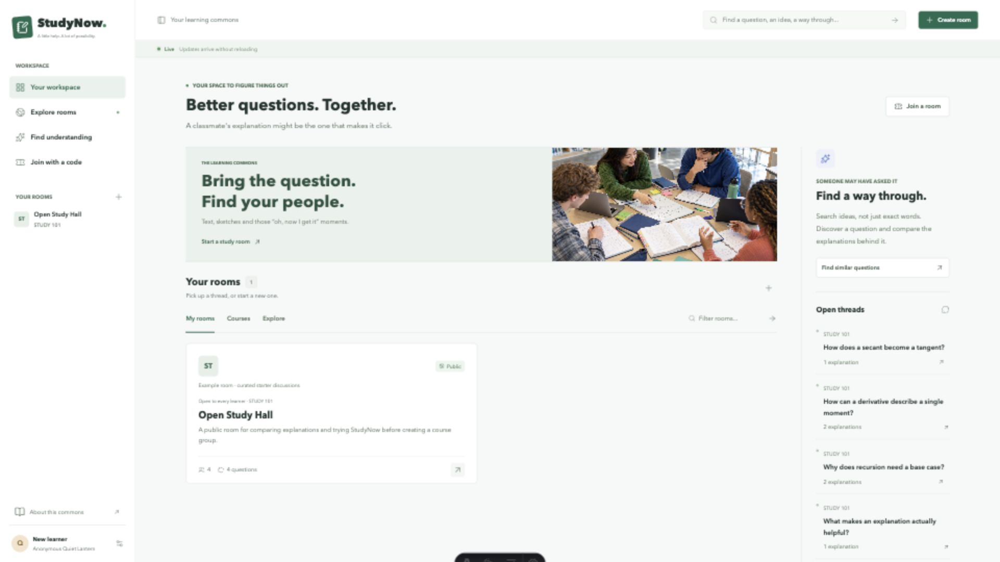
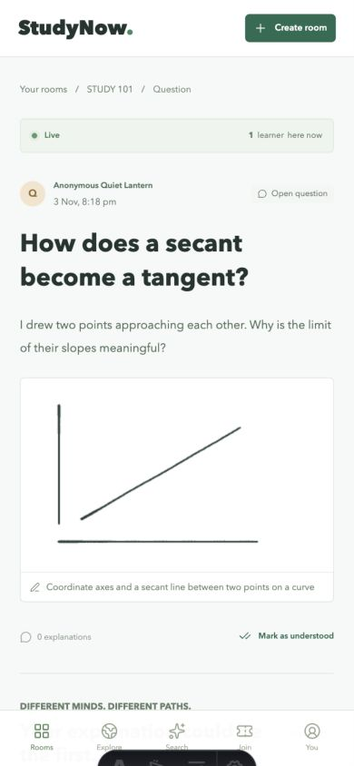

# Building StudyNow

I wanted a shared place where student groups could gather around questions as
they arise, ask and answer in real time, and work across countries using text,
images and handwriting. My priority was discussion that helps people work
through a problem together, not another feed or a private chatbot. Anonymity
supports that purpose, but it is not the whole idea.

## Turning my aim into rules

I needed a definition of good that reached beyond a feature list.
[59f2614](https://github.com/comp4020-agentic-coding-studio/comp4020-final-xty116/commit/59f2614)
records the starting rules: retain different explanations, protect private-course
boundaries and avoid popularity scores. For my final argument, I use
[Edmondson's account](https://www.hbs.edu/ris/download.aspx?name=02-062.pdf) of
interpersonal risk to consider anonymity;
[Mazur's Peer Instruction](https://mazur.harvard.edu/presentations/peer-instruction-getting-students-think-class-0)
supports learners explaining reasoning to one another. Neither proves that
StudyNow improves learning.

I connect those ideas to observable commitments: safe participation means
membership checks and anonymous presentation, tested through outsider reads
and recognisable-name sentinels. Help remaining useful tomorrow means durable
storage, tested through restarts. I leave the usefulness of an explanation to
human judgement rather than treating a passing test as educational evidence.

The first implementation deferred images and retrieval until joining, asking
and answering were durable. I still wanted visual discussion; that sequence
reduced simultaneous unknowns instead of quietly dropping the original aim.
Course invitations remained possession-based, not a claim to verify teachers
or university enrolment.

## My stack and agent workflow

My implementation follows the one-process choice in [ADR 001](docs/adr-001-stack.md):
Astro SSR and SQLite rather than a separate React/Express client or managed
backend. With one 256 MB machine and one volume, this keeps rendering,
permissions and storage close together. Native HTTP forms preserve core actions
without JavaScript. The costs I accept are synchronous database work, limited
write concurrency and no horizontal replicas.

I supplied the product direction and requests for completeness and polish;
the agent implemented changes and executed automated and browser checks.
Acceptance relied on running-app contracts and visual evidence, not the
agent's summary alone.
[3e23482](https://github.com/comp4020-agentic-coding-studio/comp4020-final-xty116/commit/3e23482)
defines two cookie identities, denied private reads and anonymous contributions;
[de07056](https://github.com/comp4020-agentic-coding-studio/comp4020-final-xty116/commit/de07056)
implements them. A recognisable display name makes accidental identity exposure
detectable. Not every feature began red: these are specific test-first sequences,
not a rewritten history of every commit. Browser inspection covers hierarchy,
visible actions and recoverable drafts that HTTP assertions cannot judge.

## What deployment changed

The first live forms failed because Fly terminates HTTPS before forwarding HTTP.
That exposed a gap between local acceptance and the production request boundary.
[e0af07b](https://github.com/comp4020-agentic-coding-studio/comp4020-final-xty116/commit/e0af07b)
trusts the exact course proxy host and adds a forwarded-header regression while
retaining foreign-origin rejection. I regard this as a harness correction:
removing origin protection would merely hide the symptom by weakening security.

## Real time without exposing private thinking

For me, being together should mean seeing submitted reasoning, not watching
someone's unfinished draft.
[d692900](https://github.com/comp4020-agentic-coding-studio/comp4020-final-xty116/commit/d692900)
requires a second session to receive a question within one second.
[e9805b2](https://github.com/comp4020-agentic-coding-studio/comp4020-final-xty116/commit/e9805b2)
and
[091b5d4](https://github.com/comp4020-agentic-coding-studio/comp4020-final-xty116/commit/091b5d4)
broadcast committed questions and explanations. Existing HTTP form writes make
SSE simpler than a second bidirectional protocol. Reconnection rebuilds from
SQLite instead of requiring replay of every event.

[ADR 002](docs/adr-002-realtime-presence.md) weighs a named roster against
invisibility and chooses aggregate presence.
[9f8a850](https://github.com/comp4020-agentic-coding-studio/comp4020-final-xty116/commit/9f8a850)
excludes recognisable names;
[345054f](https://github.com/comp4020-agentic-coding-studio/comp4020-final-xty116/commit/345054f)
patches discussion regions, never the composer. I accept weaker direct
coordination to preserve anonymous reading and private drafting.

## Making failures legible

I also need operational evidence without another identity leak.
[9685afe](https://github.com/comp4020-agentic-coding-studio/comp4020-final-xty116/commit/9685afe)
inspects the built server's stdout;
[897a067](https://github.com/comp4020-agentic-coding-studio/comp4020-final-xty116/commit/897a067)
adds correlated events. Later contracts exposed missing denial paths;
[ad54a38](https://github.com/comp4020-agentic-coding-studio/comp4020-final-xty116/commit/ad54a38)
records rejected collaboration too. [ADR 003](docs/adr-003-operational-identity.md)
uses a short session digest rather than authentication cookies, names or
contribution text. The digest correlates actions; it never grants access.

## Completing visual participation

Text alone did not satisfy my aim of discussing diagrams and handwritten working.
[3fb2b9a](https://github.com/comp4020-agentic-coding-studio/comp4020-final-xty116/commit/3fb2b9a)
commits image bytes with their parent contribution. [ADR 004](docs/adr-004-visual-retrieval.md)
rejects ephemeral files and an extra object-store dependency, accepting larger
database backups.
[23dc90a](https://github.com/comp4020-agentic-coding-studio/comp4020-final-xty116/commit/23dc90a)
adds organiser-only rosters and single-use invitations after a missing-endpoint
failure.
[6ea764e](https://github.com/comp4020-agentic-coding-studio/comp4020-final-xty116/commit/6ea764e)
integrates Signature Pad, image previews and recoverable drafts.

The review correction in
[434e6ef](https://github.com/comp4020-agentic-coding-studio/comp4020-final-xty116/commit/434e6ef)
replaces plausible image-header checks with full Sharp decoding and sizes the
canvas before restoring strokes. Malformed-byte rejection became executable;
restored edge strokes were inspected in the browser. Those are different kinds
of evidence, and I keep them separate.

I wanted the interface to make finding a discussion easier, not just look polished.
The empty first-visit panel gave way to an immediately joinable example.
[6af3219](https://github.com/comp4020-agentic-coding-studio/comp4020-final-xty116/commit/6af3219)
corrects a clipped phone action. Native dialogs retain ordinary links, focus
containment and Escape rather than creating decorative dead ends.

## Retrieval and concurrency

My retrieval aim is to reconnect learners with existing discussions, not replace
their explanations with an authoritative generated answer.
[5266365](https://github.com/comp4020-agentic-coding-studio/comp4020-final-xty116/commit/5266365)
authorises candidates before model contact and validates returned IDs again.
Its fake upstream proposes forbidden and invented sources, then fails; the
contract requires filtered sources and labelled keyword fallback.

A specification review found a newer search could finish before an older
refresh, leaving a peer update stranded.
[434e6ef](https://github.com/comp4020-agentic-coding-studio/comp4020-final-xty116/commit/434e6ef)
commits a regression expecting three requests but observing two.
[495a9a9](https://github.com/comp4020-agentic-coding-studio/comp4020-final-xty116/commit/495a9a9)
drains queued work after releasing the refresh lock. The test also keeps
unfinished query text local. I see this as a concrete connection between
concurrency correctness and draft privacy.

## What I can and cannot claim

The course model answered from my VPN-connected computer, but its ANU-only
gateway remains unreachable from Fly. The disclosure in
[6af3219](https://github.com/comp4020-agentic-coding-studio/comp4020-final-xty116/commit/6af3219)
keeps that limitation explicit. I do not count a test-double reply or keyword
fallback as working production AI.

The recorded acceptance run passed 18 tests; ten additional checks exercised
the public deployment. Restart and redeploy checks preserved private content.
Browser checks at 1920x1080 and 390x844 exercised sketch publication, recovery
and peer updates. These were agent-operated checks, not a classmate usability
study. I still need real learner feedback to judge usefulness and comfort.

The [evidence appendix](docs/process-evidence.md) traces each incident;
[verification notes](docs/verification.md) separate its results and limitations.
The preserved crit tags and linked commits keep earlier stages inspectable.

