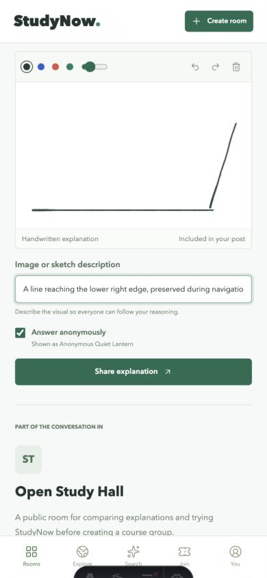
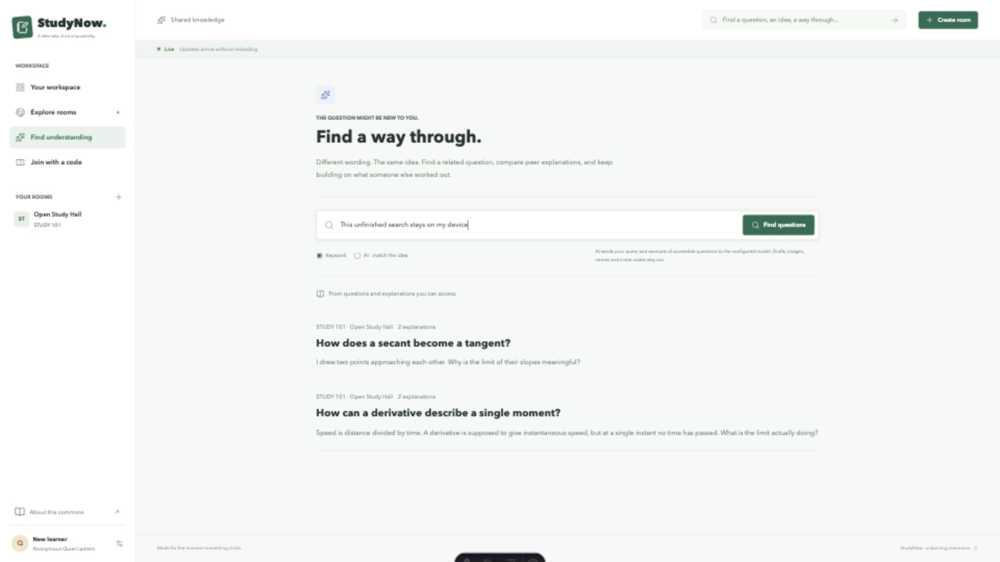
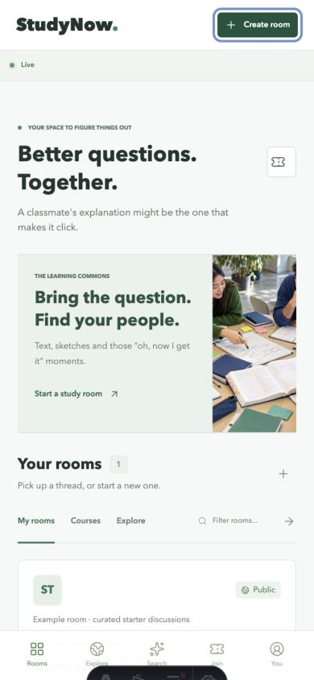

# Detailed process evidence

This appendix traces the decisions in [PROCESS.md](../PROCESS.md) to the
committed implementation, executable contracts and recorded acceptance checks.
It supports, rather than replaces, the main argument. Product direction and
agent-operated verification are distinguished throughout; no student interviews,
classroom deployment or two-classmate usability study are claimed.

## Reading the evidence

Commit links identify the state in which a decision or correction landed.
The current tests describe repeatable contracts; a passing test is evidence
about its assertions, not everything suggested by its name. Screenshots show
particular browser states, not educational effectiveness. CI records establish
that a particular revision passed and deployed, not that every external service
was reachable. [Verification notes](verification.md) retain that separation.

### The argument translated into checks

| Product judgement                                    | Rule imposed on implementation                                        | Evidence a reader can inspect                                                                                                                                     |
| ---------------------------------------------------- | --------------------------------------------------------------------- | ----------------------------------------------------------------------------------------------------------------------------------------------------------------- |
| Asking should not require exposing a real name       | Stable browser identity is distinct from anonymous presentation       | [Private multi-person flow](../spec/studynow.test.ts) uses a recognisable name and excludes it from anonymous output                                              |
| A private course is not a public feed                | Every page, attachment, search and stream checks membership           | [Search privacy](../spec/search.test.ts), [media privacy](../spec/media.test.ts), and the private-stream contract in [studynow.test.ts](../spec/studynow.test.ts) |
| Several explanations can remain useful               | Answers append independently; there is no popularity-selected winner  | [Concurrent answers](../spec/search.test.ts) and the schema/transaction rules in [db.ts](../src/lib/db.ts)                                                        |
| Being together should not expose unfinished thinking | Live updates replace display regions, never the composer or its draft | [Client race regression](../spec/search-live.test.ts) plus [browser evidence](verification.md#browser-evidence)                                                   |
| Help should be findable tomorrow                     | Commit state to the persistent database, not just process memory      | A real child-process restart in [retrieval.test.ts](../spec/retrieval.test.ts), followed by private text and image reads                                          |
| A model is not a substitute classmate                | Retrieve existing authorised sources and label failure honestly       | The forbidden-ID, invented-ID and unavailable-upstream cases in [retrieval.test.ts](../spec/retrieval.test.ts)                                                    |

## How the agent's work was constrained

On 5 November the student clarified the priority in their own words: student
groups need a place to gather, ask and answer as questions arise, with global
participation and text, image and handwriting support for working through a
problem. This is a paraphrase of the student's direction in conversation, not
a finding from market research. It explains why the project keeps a live shared
discussion with several visual explanations instead of becoming a private
chatbot or a static repository of answers. Anonymity serves that discussion;
it is not a substitute for it.

The initial harness in
[59f2614](https://github.com/comp4020-agentic-coding-studio/comp4020-final-xty116/commit/59f2614)
set privacy, durability and several coexisting explanations before interface
expansion. Later corrections enlarged the rules and checks. This matters because
asking an agent to try again would not prevent the next change from repeating
the same mistake.

The recurring workflow was: identify an observable boundary, constrain the
change, exercise its real HTTP interface, inspect the browser when appearance
or draft behaviour mattered, then commit the result. It was not perfectly
test-first. The initial group contract, realtime delivery, activity logging and
the queued-search regression have explicit test-before-implementation history;
some final features and their tests landed together. The process account does
not recast all commits as red-green cycles.

Two read-only agent reviews examined standards and specification separately.
Their findings prompted validation, canvas restoration, denial logging and
concurrency corrections. These were agent reviews, not independent human user
research. Their value lies in the resulting inspectable fixes and regressions,
not in the fact that another agent approved the work.

## Incident 1: correct local forms failed behind the live proxy

**Observed boundary.** Fly presents HTTPS to the browser but forwards a request
to the application over HTTP. A check that compares the submitted public origin
with only the internal request origin can reject a legitimate write.

**Rejected shortcut.** Removing origin protection would permit the intended
submission but also remove protection against foreign-origin writes. The local
happy path was therefore insufficient evidence for accepting the deploy.

**Correction.**
[e0af07b](https://github.com/comp4020-agentic-coding-studio/comp4020-final-xty116/commit/e0af07b)
configures the exact trusted course proxy host in Astro and adds a request
containing the public origin and forwarded host/protocol. The expected result
is the normal 303 form redirect. The existing foreign-origin request still
expects 403. Compare the two cases in [studynow.test.ts](../spec/studynow.test.ts).

**Consequence.** The harness now represents the actual hosting boundary rather
than making security weaker to accommodate deployment. It does not establish
that arbitrary forwarded hosts should be trusted.

## Incident 2: realtime transport was not the whole interaction

**Decision.** Writes already used HTTP forms. SSE could carry one-way committed
updates without introducing a second bidirectional command protocol. SQLite
remained authoritative, so reconnecting browsers could rebuild their view even
if events had been missed. The accepted limitation is one process for fan-out;
the system is not a multi-replica messaging service.

**Evidence.** The timed receiving-session contract arrives in
[d692900](https://github.com/comp4020-agentic-coding-studio/comp4020-final-xty116/commit/d692900).
Question and explanation delivery follow in
[e9805b2](https://github.com/comp4020-agentic-coding-studio/comp4020-final-xty116/commit/e9805b2)
and
[091b5d4](https://github.com/comp4020-agentic-coding-studio/comp4020-final-xty116/commit/091b5d4).
The running-app test allows one second for the expected event and separately
refuses an unauthorised private stream. This measures server delivery; it is
not a general internet latency guarantee.

**Product judgement.** A named live roster could expose who was reading a
question even when posts were anonymous. [ADR 002](adr-002-realtime-presence.md)
chooses a distinct-session count instead, accepting weaker direct coordination.
[9f8a850](https://github.com/comp4020-agentic-coding-studio/comp4020-final-xty116/commit/9f8a850)
encodes the absence of recognisable names.
[345054f](https://github.com/comp4020-agentic-coding-studio/comp4020-final-xty116/commit/345054f)
updates discussion regions while leaving forms alone. In the recorded browser
check, a peer answer appeared while the original text and sketch drafts stayed
intact. Those drafts were not live-shared whiteboards.

## Incident 3: useful logs initially omitted important failures

**Risk.** Showing successful actions alone hides why a second participant cannot
join or answer. Printing raw sessions instead would make the operational log a
source of reusable browser credentials.

**Correction sequence.**
[9685afe](https://github.com/comp4020-agentic-coding-studio/comp4020-final-xty116/commit/9685afe)
tests stdout from the production build, and
[897a067](https://github.com/comp4020-agentic-coding-studio/comp4020-final-xty116/commit/897a067)
adds structured correlated activity. The later contracts
[9cd3823](https://github.com/comp4020-agentic-coding-studio/comp4020-final-xty116/commit/9cd3823)
and
[a627fc1](https://github.com/comp4020-agentic-coding-studio/comp4020-final-xty116/commit/a627fc1)
make missing denial and invalid outcomes visible; fixes land in
[52be28e](https://github.com/comp4020-agentic-coding-studio/comp4020-final-xty116/commit/52be28e)
and
[ad54a38](https://github.com/comp4020-agentic-coding-studio/comp4020-final-xty116/commit/ad54a38).
The final review adds denied status changes to the checked outcomes too.

**Trade-off.** [ADR 003](adr-003-operational-identity.md) specifies a short digest
of a high-entropy session alongside its anonymous label, action, result and
resource IDs. The digest is a correlation aid, not authentication. The tests
check distinguishable actors while rejecting raw credentials, display names and
contribution text. They do not claim that hosting logs replace durable product
history or that a short digest has zero collision risk.

## Incident 4: visual contributions needed more than a file picker

**Persistence choice.**
[3fb2b9a](https://github.com/comp4020-agentic-coding-studio/comp4020-final-xty116/commit/3fb2b9a)
stores attachments and parent contributions in the same SQLite transaction.
Container-local files would disappear during redeployment. A separate object
store would introduce another credential, retention boundary and consistency
problem. [ADR 004](adr-004-visual-retrieval.md) accepts larger database backups
instead, with bounded upload count and size.

**Failed assumption.** Checking a PNG signature and dimensions does not prove
the remaining bytes describe a decodable image. The final review correction in
[434e6ef](https://github.com/comp4020-agentic-coding-studio/comp4020-final-xty116/commit/434e6ef)
uses full Sharp decoding with a pixel limit and serial validation. The
[malformed upload test](../spec/media.test.ts) supplies a plausible header with
truncated pixel data and requires rejection without publishing a contribution.
Other cases read valid uploads as a member and require 404 for a stranger.

**Draft recovery correction.** Signature Pad strokes could exist in session
storage while restoration clipped them against the canvas's default 300x150
bitmap. The fix sets the bitmap dimensions before restoring scaled strokes.
The browser check put strokes near the lower-right edge, reloaded and observed
the 344x213 canvas with those strokes intact. This is direct visual evidence,
not a claim that an HTML canvas element alone proves drawing works.



## Incident 5: an unusual response order stranded a peer update

The search regression is the clearest example of changing the harness instead
of retrying an operation until it looked right.

1. Start a background refresh for the first submitted search.
2. Submit a second search before that refresh completes.
3. Receive another peer's update while both requests remain pending.
4. Finish the second search, then finish the older refresh.
5. Check that a third request drains the pending update using the second
   submitted query, not the third query still being typed.

Before the fix, the superseded refresh exited on a revision mismatch. Its
cleanup released the refresh lock but left queued work stranded. The displayed
answer count could remain stale until another event or user action.
[434e6ef](https://github.com/comp4020-agentic-coding-studio/comp4020-final-xty116/commit/434e6ef)
commits the regression requiring three requests, initially observing only two.
[495a9a9](https://github.com/comp4020-agentic-coding-studio/comp4020-final-xty116/commit/495a9a9)
drains pending work after releasing the lock.

[search-live.test.ts](../spec/search-live.test.ts) controls response order
explicitly rather than depending on lucky timing. It also asserts that the
unfinished query remains in the field and is not sent by a background update.
This ties correctness to the product's draft-privacy rule. Its jsdom execution
is not a substitute for inspecting the real browser; the recorded live-search
check separately observed the explanation count changing without a reload.



## Incident 6: tested model integration was not a reachable deployed model

**Product choice.** The user asked for similar discussions to be findable. A
general answer generator could replace the peer explanation rather than help
someone rediscover it. The adapter in
[5266365](https://github.com/comp4020-agentic-coding-studio/comp4020-final-xty116/commit/5266365)
therefore reranks existing authorised discussions and links back to sources.

**Contract evidence.** [retrieval.test.ts](../spec/retrieval.test.ts) runs a fake
upstream that returns a valid source, a private source the searching stranger
cannot access, and an invented ID. Only the valid source may survive, and the
captured request must exclude the private sentinel. A simulated 503 must produce
explicit keyword fallback. The same test restarts the actual application process
on its retained database and verifies private text and image access again.

**Operational finding.** The course model answered from the student's
VPN-connected computer, but the Fly deployment returned fallback. The
[official gateway documentation](https://comp.anu.edu.au/courses/comp4020-agentic-coding-studio/topics/llm-access/)
explains the ANU-network restriction. A laptop VPN does not place a remote Fly
machine on that network. The deployment disclosure in
[6af3219](https://github.com/comp4020-agentic-coding-studio/comp4020-final-xty116/commit/6af3219)
records that live AI is incomplete. No test double or HTTP 200 fallback is
presented as a successful production model request.

**Boundary retained.** Credentials were stored only in authorised encrypted
GitHub/Fly configuration, never source or browser storage. Visitors are not
asked to supply a key or run a local relay. A reachable authorised provider
remains necessary; [the Ed question](model-gateway-request.md) is a draft, not
evidence of teacher approval or a message already sent.

## Presentation changes had acceptance conditions

The workspace integration in
[6ea764e](https://github.com/comp4020-agentic-coding-studio/comp4020-final-xty116/commit/6ea764e)
replaced the first-visit empty-room emphasis with an immediately joinable
example, established a stable photographic band, and integrated text, image
and sketch controls. Signature Pad supplies the stroke engine and Lucide the
icon set; the project does not claim to have written those libraries.

The 390x844 inspection subsequently found a clipped action in the commons band.
[6af3219](https://github.com/comp4020-agentic-coding-studio/comp4020-final-xty116/commit/6af3219)
reduces its heading from 25px to 21px and increases supporting copy from 9px to
11px. The recorded action bottom was 500.9px inside a band ending at 537.5px;
the document width remained 390px. At 1920x1080 the document width was 1920px.
These observations support those viewports, not an assertion that every device
or accessibility preference has been studied.



## Acceptance and what is still unknown

The 3 November record contains 18 passing tests in nine files and ten additional
checks against the public app. Deployment
[41619761234](https://github.com/comp4020-agentic-coding-studio/comp4020-final-xty116/actions/runs/41619761234)
passed the course checks, evidence validation, both secret scans and live health
verification at revision
[6af3219](https://github.com/comp4020-agentic-coding-studio/comp4020-final-xty116/commit/6af3219).
Private text created before deployment was readable afterwards; a private PNG
also retained identical bytes across that release, while an unauthenticated
read still returned 404. This is separate from the isolated process-restart test.

To repeat the automated checks, use the repository's documented local server
setup in [spec/README.md](../spec/README.md), then run:

```sh
pnpm check
pnpm check:evidence
```

The public live entry is [the marker README](https://comp4020-final-xty116.fly.dev/readme/).
Its two-profile journey is free and browser-only. The crit 8, 9 and 10 tags and
reflections remain historical snapshots; the final account is rewritten, not
appended to those reflections.

Remaining judgements include whether anonymity actually lowers hesitation,
which explanations learners find useful, and how a real class distributes its
invitations. Those need participants, not invented testimonials. The checks
also do not establish high-load capacity, institutional identity verification,
OCR of handwritten images or a shared live drawing canvas. Clear boundaries
are part of the result, not features silently assumed to be complete.
